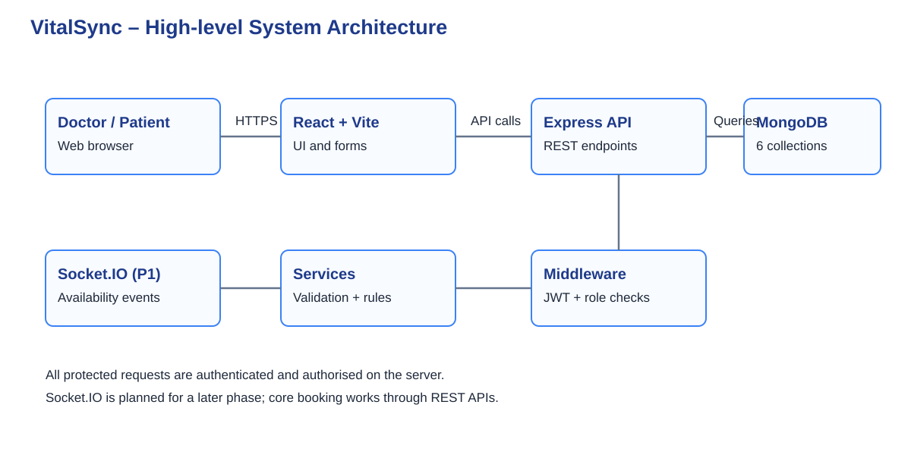
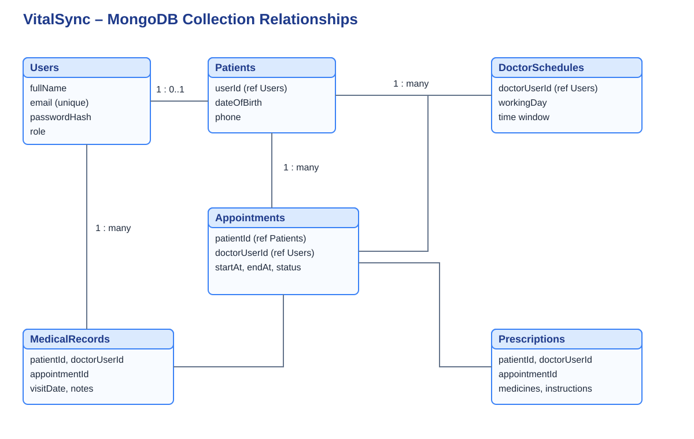

# VitalSync – Healthcare & Patient Record Management System

## Project Overview
VitalSync is a web-based healthcare record and appointment management platform. It is planned for two main user roles: **Doctor** and **Patient**. The goal is to keep appointment information, patient details, medical history and prescriptions organised in one place.

This repository contains the planning documents for Sprint 13. The application itself is **not implemented in this sprint**. The current work focuses on requirements, UI planning and system architecture.

## Project Details
- **Project name:** VitalSync
- **Project type:** Healthcare EHR and appointment management dashboard
- **Track:** Fullstack
- **Primary users:** Doctor and Patient
- **Development approach:** Individual contributor; MVP first, then improvements

## Problem Statement
Patient information and appointment details can be spread across separate records and manual processes. This makes it harder to find previous visit information, check appointment status and keep prescriptions connected to the correct patient.

VitalSync proposes a single web application where patients can manage their appointments and view their own records, while doctors can review assigned patient information and maintain consultation records.

## Project Goals
1. Provide separate, role-aware dashboards for doctors and patients.
2. Allow patients to view doctors' available appointment slots and request bookings.
3. Help doctors review their upcoming appointments and assigned patient records.
4. Keep medical history and prescriptions linked to the relevant patient.
5. Make the interface usable on desktop, tablet and mobile screens.

## User Roles and Permissions
| Capability | Patient | Doctor |
|---|---|---|
| View/update own basic profile | Yes | Yes |
| Browse doctor availability | Yes | No |
| Request/cancel own appointment | Yes | No |
| View own appointments | Yes | Yes (doctor's schedule) |
| View medical history | Own records only | Assigned patients only |
| Add consultation note | No | Yes |
| Create prescription | No | Yes |
| View prescription | Own prescriptions | Prescriptions they issued |

Every protected API request must be authorised on the server. A user must not gain access to another patient's record by changing an ID in the URL.

## Core Features (Prioritised)
### P0 – MVP
- Login and registration with Doctor/Patient roles
- Role-aware navigation and dashboard
- Patient profile
- Doctor schedule and available time slots
- Appointment booking, cancellation and status tracking
- Doctor's appointment list
- Medical history timeline for an assigned patient
- Prescription creation by a doctor and read-only viewing by the patient
- Form validation, loading states and useful error messages

### P1 – After MVP
- Live appointment availability updates
- Search and filters for appointment lists
- Notification centre for booking status changes
- Downloadable prescription view
- Audit history for sensitive record access

### Out of Scope for the first release
- Online payments and insurance claims
- Video consultations
- Pharmacy inventory
- AI diagnosis or treatment recommendations
- Lab equipment integrations
- Real patient data or production hospital deployment

## Main User Flows
### Patient
Register/Login → Patient Dashboard → Browse Doctors/Slots → Request Appointment → View Appointment Status → View Medical History and Prescriptions.

### Doctor
Login → Doctor Dashboard → Review Today's Appointments → Open Assigned Patient → Review History → Add Consultation Note → Create Prescription.

## Technology Stack
| Layer | Planned technology | Purpose |
|---|---|---|
| Frontend | React + Vite | Single-page web interface |
| Styling | Tailwind CSS | Responsive layouts |
| UI components | shadcn/ui (customised) | Consistent form and dashboard components |
| Backend | Node.js + Express | REST API and business rules |
| Database | MongoDB + Mongoose | Persistent application records |
| Authentication | JWT + bcrypt | Session token and password hashing |
| Real-time updates | Socket.IO (P1) | Appointment availability/status events |
| Design | Figma | Wireframes and responsive layouts |
| Diagrams | Draw.io | ERD and architecture diagrams |

## Planned Database Collections
1. **Users** – name, email, password hash, role and account status.
2. **Patients** – user reference, date of birth, contact details and basic profile information.
3. **Appointments** – patient reference, doctor reference, start/end time, reason and status.
4. **DoctorSchedules** – doctor reference, working days, slot duration and availability windows.
5. **MedicalRecords** – patient reference, doctor reference, appointment reference, visit date and clinical notes.
6. **Prescriptions** – patient reference, doctor reference, appointment reference, medicines and instructions.

References between collections use MongoDB ObjectIds. Sensitive information is not duplicated unnecessarily. Exact indexes and validation rules will be finalised before implementation.

## Planned API Endpoints
All routes are prefixed with `/api`.

| Method | Endpoint | Access | Purpose |
|---|---|---|---|
| POST | `/auth/register` | Public | Create an account |
| POST | `/auth/login` | Public | Sign in |
| GET | `/users/me` | Authenticated | Current user's profile |
| PATCH | `/users/me` | Authenticated | Update own basic profile |
| GET | `/doctors` | Authenticated | Browse doctors |
| GET | `/doctors/:doctorId/availability` | Authenticated | View available slots |
| POST | `/appointments` | Patient | Request a booking |
| GET | `/appointments` | Patient/Doctor | List role-scoped appointments |
| PATCH | `/appointments/:id/cancel` | Owner/authorised doctor | Cancel appointment |
| PATCH | `/appointments/:id/status` | Assigned doctor | Update appointment status |
| GET | `/patients/:patientId` | Assigned doctor or patient owner | View permitted patient profile |
| GET | `/patients/:patientId/records` | Patient owner/assigned doctor | View permitted history |
| POST | `/patients/:patientId/records` | Assigned doctor | Add consultation record |
| GET | `/patients/:patientId/prescriptions` | Patient owner/issuing doctor | View prescriptions |
| POST | `/patients/:patientId/prescriptions` | Assigned doctor | Create prescription |

The endpoint list is a planning contract, not a claim that the routes already exist.

## Important Business Rules
- A patient can only view and update their own profile and records.
- A doctor can access records only for patients assigned through a valid appointment/care relationship.
- The server checks permissions on every protected request; hiding a UI control is not security.
- A slot cannot be confirmed for two patients. Booking must re-check availability at write time and use a database-safe conflict strategy.
- Appointment statuses are limited to `requested`, `confirmed`, `completed` and `cancelled`.
- Only the assigned doctor can add a consultation record or issue a prescription for that visit.
- Use fictional sample data only during development and demonstrations.

## Non-Functional Requirements
- Responsive layout for mobile, tablet and desktop.
- Passwords stored as hashes, never plain text.
- Validate and sanitise incoming data.
- Use HTTPS in deployment and keep secrets in environment variables.
- Return consistent API errors without exposing stack traces or sensitive details.
- Maintain audit events for sensitive record actions in a later iteration.
- Provide accessible labels, keyboard focus states and readable contrast.

## UI/UX Plan
The first wireframe set contains:
1. Login and role selection
2. Role-aware dashboard
3. Patient details and medical history

Editable SVG wireframes are in [`docs/wireframes/`](docs/wireframes/). Import the SVG files into Figma, then add a separate mobile frame for each screen. The SVGs are starting layouts, not final visual designs.

**Figma file:** Add the public Figma link here after creating and publishing the design file.

## Architecture

### High-level system architecture

### Database ER diagram

- [System architecture details and request flow](docs/system-architecture.md)
- [ER diagram and collection relationship notes](docs/erd.md)
- [Planned API contract](docs/api-plan.md)

## Sprint Roadmap
| Sprint | Planned work |
|---|---|
| Sprint 13 | PRD, wireframes, ERD and architecture |
| Sprint 14 | MVP setup, authentication, role-aware layouts and profiles |
| Sprint 15 | Appointment and medical record CRUD flows |
| Sprint 16 | Prescription flow, real-time updates and UX improvements |
| Sprint 17 | Testing, security review, CI/CD and deployment |

## Risks and Open Questions
- Appointment slot conflicts need a database-level strategy, not only a frontend check.
- Medical data is sensitive; access rules must be tested for both roles.
- This is an educational prototype, not a certified clinical system. It must not be used for real patient care.
- Before a real deployment, applicable healthcare, privacy, retention and security requirements must be reviewed with qualified stakeholders.

## References
- [HL7 FHIR R4](https://hl7.org/fhir/R4/) – healthcare data concepts and interoperability reference.
- [OWASP Authorization Cheat Sheet](https://cheatsheetseries.owasp.org/cheatsheets/Authorization_Cheat_Sheet.html) – authorization design guidance.
- [OWASP Developer Guide: Access Controls](https://devguide.owasp.org/en/04-design/02-web-app-checklist/07-access-controls/) – access-control checklist.

---
*Sprint 13 planning document. Implementation details may be refined after the architecture review.*
