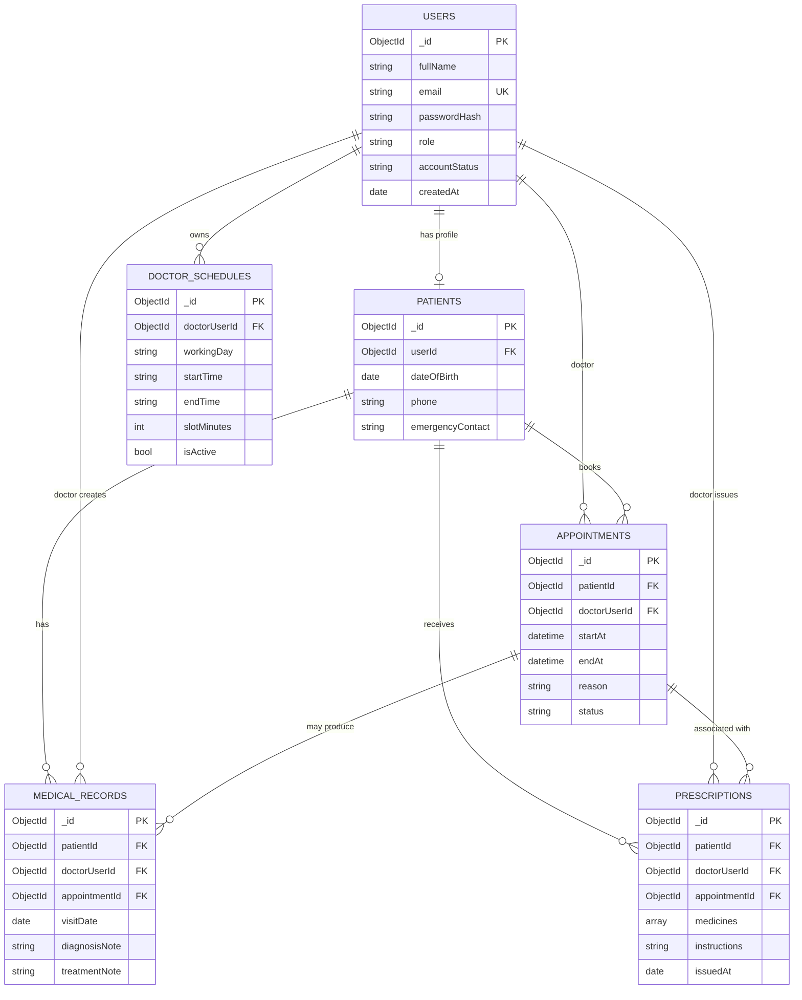

# VitalSync – ER Diagram and Collection Plan

## Relationship notes
- A User has a role of `patient` or `doctor`. Patient-specific profile details live in Patients; doctor schedule entries refer to the doctor's User record.
- A Patient can have many Appointments, MedicalRecords and Prescriptions.
- A Doctor can have many Appointments, MedicalRecords and Prescriptions.
- An Appointment can be linked to a consultation record and one or more prescription documents.
- The diagram shows logical relationships. MongoDB does not enforce foreign keys in the same way as a relational database; references must be validated by application logic.

## Initial indexes to consider
- `Users.email`: unique index.
- `Appointments`: compound index on doctor and start time; add a conflict-prevention strategy for confirmed bookings.
- `MedicalRecords`: index on patient and visit date.
- `Prescriptions`: index on patient and issued date.

The exact appointment conflict strategy should be finalised during implementation and tested with concurrent booking requests.
