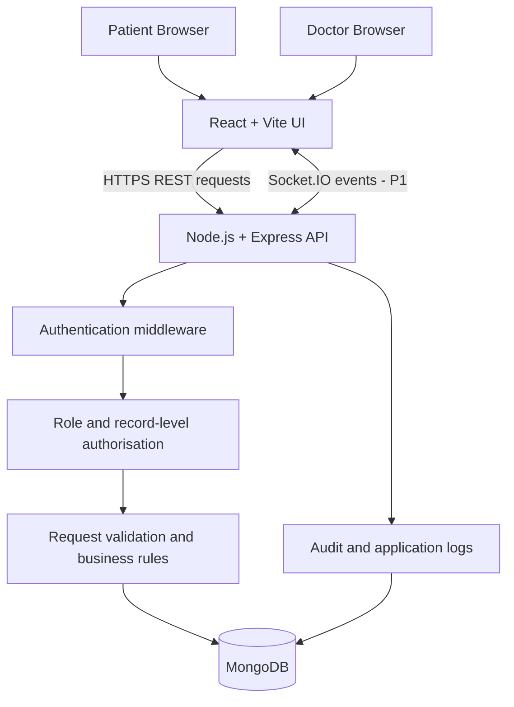

# VitalSync – System Architecture

## High-level architecture

## Request flow: patient books an appointment
1. Patient signs in and receives an authentication token.
2. React sends a booking request to `POST /api/appointments`.
3. Express authentication middleware verifies the token.
4. Authorisation middleware confirms that the caller has the Patient role and is booking for their own account.
5. The request validator checks the doctor, date, time and required fields.
6. The appointment service checks the doctor's schedule and re-checks that the slot is still free.
7. The server writes the appointment using a conflict-safe strategy. A frontend-only availability check is not sufficient.
8. The API returns the saved appointment and its status.
9. In the later real-time phase, Socket.IO can publish an availability/status update to connected clients.

## Security boundaries
- The browser is not trusted to enforce permissions.
- Every protected API request is checked on the server.
- Patients are restricted to their own records.
- Doctors are restricted to patients connected to an authorised care relationship or appointment.
- Secrets are stored in environment variables and never committed to Git.
- Use fictional data in development and demos.

## Planned application layers
| Layer | Responsibility |
|---|---|
| React UI | Screens, forms, navigation and user feedback |
| Express routes | HTTP endpoints and request/response handling |
| Middleware | Authentication, role checks and validation |
| Services | Appointment rules and record workflows |
| Mongoose models | MongoDB schema and persistence |
| MongoDB | Users, patients, schedules, appointments, records and prescriptions |

## Architecture decisions
- REST is used for the main application operations because the resources map naturally to users, doctors, appointments and records.
- Socket.IO is planned for later availability updates; it is not required to complete the first booking flow.
- MongoDB references are used for records that have their own lifecycle and are queried independently.
- The prototype is educational and is not a certified clinical system.
